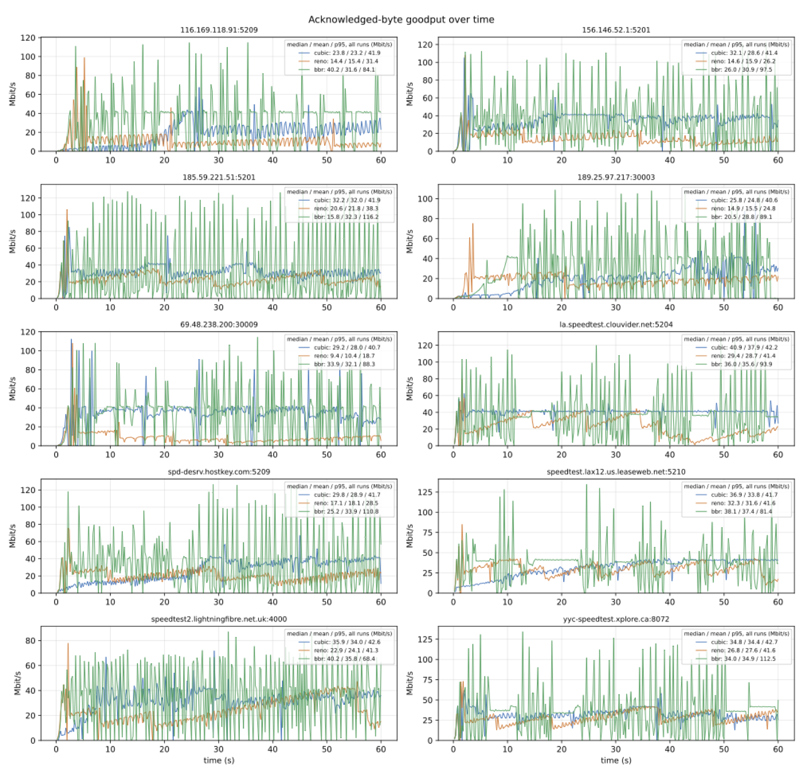
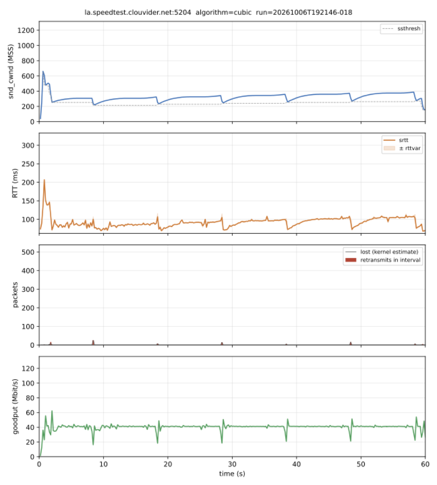
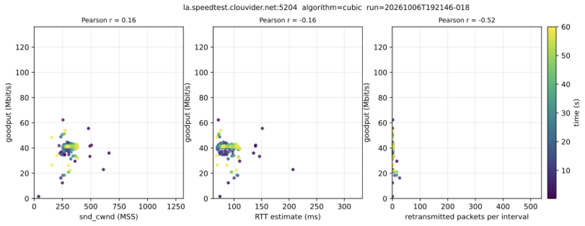
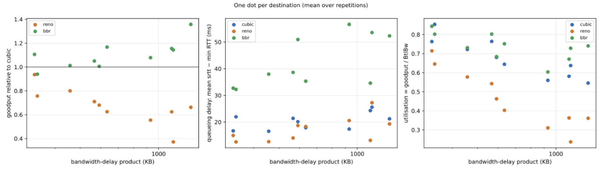
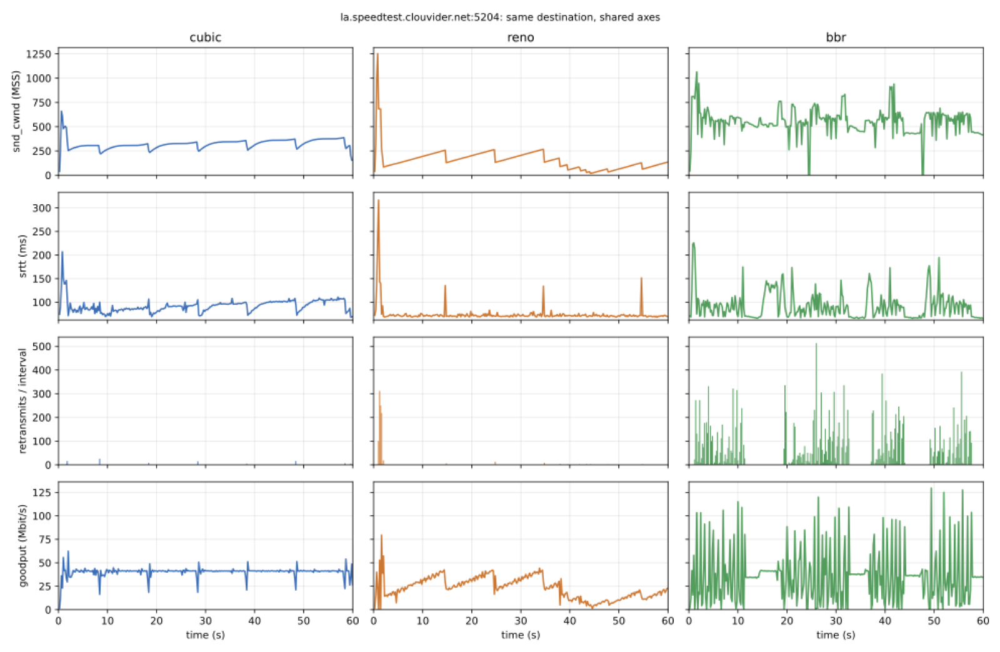
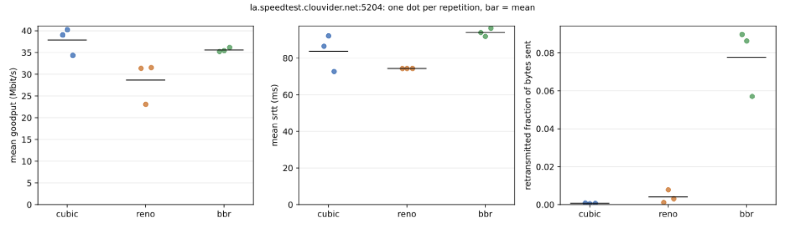

# CS422 HW2 – iperf3 client, TCP stats tracing, CUBIC/Reno/BBR comparison

One command runs everything: `run_experiments.py` picks servers, runs iperf3 TCP tests for cubic, reno and bbr
(with repetitions), saves raw data, and produces PDF plots and summary tables.

| File | Purpose |
|---|---|
| `run_experiments.py` | **Entry point**: server selection, test loop, raw output, then calls `analyze.py` |
| `iperf_client.py` | From-scratch iperf3 TCP client (protocol steps in its docstring) + `getsockopt(TCP_INFO)` decoding |
| `analyze.py` | Plots (PDF) and summary tables from `samples.csv` |
| `servers.txt` | Snapshot of iperf3serverlist.net (`host:port` or `host:first-last` per line) |
| `Dockerfile`, `run_docker.sh` | `ubuntu:24.04` image / one-command build + run |
| `requirements.txt` | numpy, matplotlib (the client itself uses only the standard library) |

## Requirements
* **Linux (Ubuntu 22.04+) or WSL2.** A container uses the *host* kernel, so TCP_INFO fields and the available
  congestion-control algorithms come from it. The host needs `cubic`, `reno` and `bbr`:
  ```
  cat /proc/sys/net/ipv4/tcp_available_congestion_control    # expect: reno cubic bbr
  sudo modprobe tcp_bbr                                       # if bbr is missing
  ```
  Non-root processes may only use `tcp_allowed_congestion_control`; run the container with `--cap-add NET_ADMIN`
  or add the algorithms to that list. Unavailable algorithms are skipped with a warning (see `environment.json`).
* Outbound TCP access to the public iperf3 servers.
* The host kernel version, default/available/allowed algorithms and all arguments are saved in `results/environment.json`.

## Run
```
./run_docker.sh                                              # Docker, defaults
./run_docker.sh --server-file servers.txt -n 10 -t 60 --interval 0.2 -r 3 --seed 1
```
Without Docker: `pip install -r requirements.txt && python3 run_experiments.py --server-file servers.txt -n 10 -t 60 -r 3`.
Re-plot saved data: `python3 run_experiments.py --out results --analyze-only`
(on a shared machine with a low process limit, set `export OPENBLAS_NUM_THREADS=1`).

## Options
| Option | Default | Meaning |
|---|---|---|
| `--server-file F` | live iperf3serverlist.net list | `host:port[-port]` per line, `#` comments |
| `-n` | 10 | destinations to obtain (random choice; failed servers are replaced) |
| `-t` | 60 | seconds per test |
| `--interval` | 0.2 | sampling interval in seconds (goodput and TCP stats share the same sample) |
| `-r` | 1 | repetitions per destination × algorithm; the algorithm order rotates each repetition |
| `--algorithms` | cubic,reno,bbr | congestion-control algorithms; set on the data socket before `connect()` |
| `--max-attempts` | 3·n | cap on servers tried; any shortfall is reported in `selected_servers.json` |
| `--seed` | none | reproducible server/port selection |
| `--representative host:port` | auto | destination for the Q2/Q3 plots |
| `--out`, `--analyze-only` | results, off | output folder; skip measurements |

Run time ≈ n × r × algorithms × (duration + ~5 s); the defaults take about 35 minutes.

## Outputs (`results/`)
* Raw: `samples.csv` (one row per sample: run, destination, repetition, algorithm, time, acked bytes, goodput,
  cwnd, RTT, rttvar, retransmits, pacing/delivery rate …), `selected_servers.json` (chosen servers, every failed
  attempt, shortfall), `environment.json` (kernel, algorithms, arguments, units, decoding notes).
* Q1: `goodput_timeseries.pdf` (legend shows median / mean / p95), `summary_by_destination.csv/.md` (min/median/mean/p95).
* Q2/Q3: `tcpstats_timeseries_<alg>.pdf` and `scatter_relationships_<alg>.pdf` for each algorithm on the same
  representative destination with identical axes (the `_cubic` files are the Q2 figures).
* Q3: `compare_timeseries.pdf`, `compare_repetitions.pdf`, `compare_regimes.pdf`, `compare_by_destination.csv/.md`,
  `compare_overall.csv/.md`, `compare_runs.csv` (every run in execution order = the test order).

## How the numbers are computed
* `getsockopt(TCP_INFO)` on the **data** socket, decoded at fixed byte offsets of `struct tcp_info` (listed in
  `tcp_stats()` and in `environment.json`): snd_cwnd, rtt/rttvar, snd_ssthresh, total_retrans, lost, pacing_rate,
  bytes_acked, delivery_rate, bytes_sent, bytes_retrans.
* **Goodput** = 8·(bytes_acked(t) − bytes_acked(t−1)) / (t − t_prev), using the measured elapsed time.
* **Loss proxy** = retransmitted packets per interval (`total_retrans` difference); `lost` is the kernel's estimate.
* **BDP** = best observed bottleneck bandwidth (95th percentile of the kernel's delivery rate) × minimum RTT;
  queueing delay = mean srtt − minimum RTT.

  ## Observations
Q1: From the goodput over time we can see that BBR is the most responsive/flexible, which makes sense since the algorithm is designed to fundamentally more flexible than the two loss-based algorithms. Meanwhile when comparing Cubic and Reno, Cubic algorithm goodput is almost always above the reno algorithm, which also makes sense it has a softer loss and more sudden growth.


*Figure Q1: acknowledged-byte goodput over time per destination (`results_3rep/goodput_timeseries.pdf`).*

Q2: Observations from the cubic TCP metrics and scatterplots.


*Figure Q2a: cwnd, RTT, loss and goodput over time for CUBIC on la.speedtest.clouvider.net:5204 (`tcpstats_timeseries_cubic.pdf`).*


*Figure Q2b: goodput vs cwnd, RTT and retransmitted packets for CUBIC on the same destination (`scatter_relationships_cubic.pdf`).*

What each metric represents: 

- snd_cwnd: This is the size of the congestion window. This is the value that gets directly updated when we are cutting down on the size of the window / growing it. In the graph it shows normal cubic behavior.

- RTT: This represents the sum of both the propagation delay and queueing delay. In particular when snd_cwnd gets too large and the packets are waiting in a queue this RTT value will also be greater. Thus, it is responsive to the send_cwnd graph.

- Loss: This is the estimated number of packets that had to be retransmitted. Packet loss is what triggers the snd_cwnd cutback so it makes sense that all of the points of cutback are when there were packet retransmission.

- Goodput: This represents the acknowledge byte rate at each elapsed time. This rate should be relatively constant with dips when there is a packet retransmission / snd_cwnd cutback.

- Goodput vs send_cwnd: What I find is that there isn't really a strong relationship between send_cwnd and goodput, more of light positive one. This makes sense since in the previous graph goodput was mostly constant except for the few times when the initial cutback / growth caused the goodput to cutback / increase.

- Goodput vs RTT: This shows how much the queueing delay affects the goodput. As we can see from the data there isn't too much of a strong relationship as goodput and RTT are not strongly related.

- Goodput vs Retransmitted Packets: This shows how retransmitted packets affects goodput. However since there are only a few times we retransmitted packets and their goodput isn't big outliers in this graph.

I don't really think anything is anomalous here.

Q3: Looking at the overall results in `compare_overall.md`, BBR has the best results since it has the highest average goodput and for 9 of the 10 destinations it had the best goodput. In terms of minimizing queueing delay it was reno that was best, which also makes sense since its snd_cwnd cut is stronger and it grows back slower (less reason to run into queueing delay). If we look at compare_regimes.pdf, we find that at shorter paths (lower BDP), BBR and cubic goodput are relatively similar (Reno is far behind), but when we get to larger BDP BBR grows out ahead. Meanwhile, queueing delay between cubic and reno is always similar as for BBR it grows on much greater.


*Figure Q3a: goodput relative to CUBIC, queueing delay and utilisation vs. bandwidth-delay product (`compare_regimes.pdf`).*


*Figure Q3b: cubic / reno / bbr time series on the representative destination (`compare_timeseries.pdf`).*


*Figure Q3c: run-to-run variation across repetitions (`compare_repetitions.pdf`).*

Q3b:

Currently we have BBR which has an advantage in goodput in longer paths (There are no hard-cuts on losses so we are able to maintain full utilization). However, the tradeoff is that BBR has a queuing cost. Cubic has a queueing advantage since it always keeps its snd_cwnd below BDP, but on losses this causes a big backoff, keeping goodput low. The goal is to take advantage of both.

1. BBR does its normal preperations: Bottelneck bandwith estimate for max recent delivery rate, find the minimum RTT.
2. We can pace at the bandwith estimate and set the send_cwnd to = BtlBw * (minRtt + queueing target) where we try to get the queuing target at around 10-20 ms (about the range of Reno and Cubic)
3. If we find that the srtt - minRTT exceeds the queuing target (queuing is taking too long), we can do a gentle trim of cwnd to reduce queuing delay.
4. If there is loss do a gentle cut (by a factor of .85) -> This is greater than the cubic loss so we won't have as much goodput dropoff as cubic. 
5. Probe for more bandwith (Slower growth rate than BBR)

Ultimately what this offers us is an in-between between the two extremes of BBR and Cubic. While BBR has the greatest goodput and Cubic has the smallest queueing delay, this algorithm exchanges some of the advantages offered by both to have an in-between of the two. This algorithm doesn't enforce fairness since it is of a similar style to BBR. Each flow is estimating its own rate.

AI tools were used to supplement code generation.


